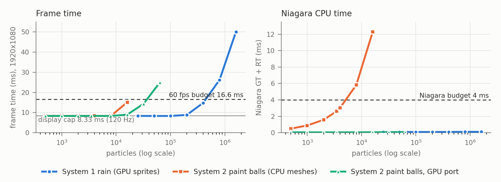

**Paint Valley** (UE 5.7, C++ + Niagara) is a standalone game in Track B's form: one mechanic, two particle configurations, switched at runtime (Tab). Instead of a flock, the player steers a stream of paint. Grid-block structures float in Monument Valley's style. The player turns a trackball to aim the paint, and the clock runs until 90 % of the cream target blocks are painted. Blockers and the ground take no paint, and the pool of paint can run out. The mechanic borrows from *Auditorium*: a particle stream bent by the player until it fills its targets.

- **System 1, paint rain:** 100k GPU sprites with 3 rules. Each drop relaxes towards the player's direction, sweeps against up to 32 level boxes, and recycles on landing.
- **System 2, paint balls:** 3.5k CPU-simulated meshes. Each ball runs a state machine (cloud, flying, resting, burst), collides with the boxes (bounce, friction, squash), and collides with its two nearest balls. That neighbour query runs on a Particle Attribute Reader bound to the emitter itself. A burst on the target is an event to gameplay.

**Two-way coupling.** Player input writes Niagara user parameters every frame: the direction, the boxes, one bit per box face already full, the share of the pool left, a freeze and a round epoch. The simulation writes back through *Export Particle Data*:

- A drop landing on a target face that is not full exports its hit point, its kind and its velocity. GPU readback arrives 2–3 frames late.
- The game paints with each hit and counts it against the pool. A small drop is used up only where it lands on paint, feeding that puddle; on bare surface it goes back to the cloud. Joined paint on one face grows as one body.
- Coverage decides the clock (win) and the empty pool decides the loss. Paint balls export their bursts the same way, synchronously on the CPU.

## Budget and method

**Budget (the same as Rain Shield's, set before either was built):** 60 fps (16.6 ms) at 1920×1080, with Niagara ≤ 4 ms on the game and render threads combined.

**Method:**

- **Machine:** MacBook Pro M2 Pro, 32 GB, Metal SM6; UE 5.7 Development; there was no lab PC to test on.
- **Run conditions:** a standalone `-game` window at 1920×1080, 100 % screen percentage, FXAA, `t.MaxFPS 0`, `r.VSync 0`.
- **Per count:** each count is one fresh process (`Scripts/paint_sweep.sh`). The round starts and runs for 6–8 s. Then 5 s of frames are averaged:
  - `stat unit`'s raw frame, game-thread and GPU times;
  - the played system's Niagara game- and render-thread time, from the engine's per-system particle perf stats (what `stat Niagara` shows).
- **Cross-checks:** `stat Niagara`, the Niagara debug HUD, `ProfileGPU` and an Unreal Insights trace (in `Docs/Perf/paint_*`).
- **Metal limitations:**
  - `stat GPU` is empty on Metal, and per-system GPU time is not reported.
  - Metal paces the frame to the display's 120 Hz even with vsync off, so the frame time cannot drop below 8.33 ms. Below that cap the reported GPU time includes the wait (7.1 ms with no particles at all), so the particles' GPU cost there comes from ProfileGPU.

**Count control and a bug it exposed.** `rain.paint.Count`, `rain.paint.Balls` and the panel's pool slider respawn a system at runtime. Logging the live count showed that a runtime change kept the old pool alive (500 balls requested, 4,000 live): `Activate(true)` re-fires the spawn burst on top of the old particles. `ReinitializeSystem()` now replaces the instance. All numbers below are from after the fix, with the live count checked.

| | count | frame ms | Niagara GT+RT ms | game thread ms |
|---|---:|---:|---:|---:|
| rain (GPU sprites) | 0 / **100k** / 400k / 800k / 1.6M | 8.33 / **8.33** / 14.8 / 26.2 / 50.0 | 0.05 / **0.10** / 0.10 / 0.11 / 0.11 | 0.9 / **1.5** / 1.4 / 1.7 / 2.0 |
| paint balls (CPU meshes) | 500 / **3.5k** / 8k / 16k | 8.33 / **8.36** / 8.35 / 12.3 | 0.51 / **2.63** / 5.83 / 11.59 | 1.5 / **3.6** / 6.6 / 12.3 |
| paint balls, GPU port | 500 / 3.5k / 16k / 32k / 64k | 8.36 / 8.35 / 8.99 / 14.4 / 25.0 | 0.06 / 0.05 / 0.07 / 0.08 / 0.07 | 1.0 / 0.9 / 0.8 / 0.8 / 0.8 |

## Scaling and breaking points

- **System 1 is GPU-bound and linear.** Above the cap, each 100k drops add 2.9 ms of GPU (29 ns a drop), on top of about 2.5 ms for the scene.
  - At 100k drops, an Insights trace averaged over 4,190 frames gives: Niagara's GPU compute dispatch 0.79 ms a frame (ProfileGPU: 0.6 ms of it is clearing the export buffer), the translucent drops 2.3 ms, the sort 0.22 ms.
  - The 16.6 ms budget breaks at about **460k drops**. The default of 100k leaves the frame at the 120 Hz cap.
  - Niagara's CPU cost stays at 0.1 ms up to 1.6M drops, so the 4 ms Niagara budget never breaks.
- **System 2 on the CPU is linear in the balls:** 0.72 µs of CPU per ball. Each ball runs branch-free VM code with 32 swept box tests, a neighbour query (9 candidate balls, 24 reader lookups) and an export.
  - The 4 ms Niagara budget breaks at about **5.4k balls**. The default of 3.5k uses 2.6 ms of it.
  - The frame holds the cap up to 8k balls. At 16k the game thread (12.3 ms) sets the pace.

## Optimisations, before → after (same build, reproducible with the cvars)

1. **CPU → GPU port of the paint balls** (`rain.paint.BallsGPU 0 → 1`: the same HLSL with the sim target flipped, and the reader and the export on the GPU).
   - At the default 3.5k balls, Niagara CPU time drops from 2.63 to 0.05 ms (−98 %), and the game thread from 3.6 to 0.9 ms. The frame stays at the cap.
   - At 16k balls, the frame drops from 12.3 to 9.0 ms (−27 %), and Niagara CPU time from 11.6 to 0.07 ms.
   - The CPU breaking point (about 5.4k balls) is gone. The GPU version breaks the frame budget at about **39k balls**, at 0.34 µs of GPU per ball (12 drops' worth).
   - In Rain Shield the same port made the frame worse, because that lit scene was GPU-bound (26.5 ms). This unlit scene leaves the GPU mostly idle, so moving work onto it pays.
   - Decision: System 2 ships on the CPU at 3.5k balls. It fits the budget with 1.4 ms to spare, and its bursts reach gameplay in the same frame. The port is kept as a runtime switch for larger counts.
   - Caveat: the port is not bit-identical in play. On Nook at 3.5k balls it painted 89 % in 13 s, against 55 % for the CPU version. The cause is not isolated yet. One suspect is the `sin`-based hashes that place each launch, whose precision differs between the VectorVM and the GPU.
2. **Pausing the idle system** (`rain.paint.PauseIdle`).
   - With 2k balls playing and 800k drops idle, paused and simulating measured the same (Niagara 1.59 ms, frame at the cap).
   - The idle drops are hidden and wait in the cloud as zero-size sprites, so they cost almost nothing. In Rain Shield, where idle drops kept falling, pausing saved 4.3 ms.

A rendering change outside Niagara mattered more than either. TSR, the default anti-aliasing, cost 12.7 ms of a 14.8 ms frame in this flat-shaded scene; with FXAA the frame reaches the 120 Hz cap.

## Many simple vs few complex

At equal frame time (the 16.6 ms budget), the machine runs **460k drops, or 39k GPU balls, or about 22k CPU balls**. On the GPU one ball costs as much as 12 drops; on the CPU it costs 25 drops' worth of time.

- **The rain makes the better base game.** Paint arrives as a smooth flux, so coverage rises predictably, and the puzzle is pure aiming: which faces a direction reaches and which ones the blockers shade. Readback is cheap (one record a landing), and the count can grow 4.6× before the budget breaks.
- **The balls make levels that the rain cannot.** Each ball is readable, and outcomes come from individual paths. On Table, a bank shot off the ground paints the slab under the table top (75 % in 10 s, against 42 % fired straight in); on Pinball, balls rebound off bumpers. That is skill expression, but outcomes are noisier, and every rule costs CPU per ball.

So each level picks its configuration. The lead engineer's version: spend particle *count* where the player reads a field, and per-particle *logic* where the player reads individuals. Keep that logic on the CPU while it fits in about 3 ms, and port it to the GPU when the count, not the logic, is what the level needs.

## With another week

1. Profile on a lab PC (D3D12, where `stat GPU` works and there is no 120 Hz pacing), and set the default counts from that data.
2. Find why the GPU port paints faster than the CPU version, make the two match, and then use the port on levels that want more balls.
3. Try a Neighbor Grid 3D on the GPU port in place of the approximate neighbour search; add Effect Type budgets; playtest the balance.
