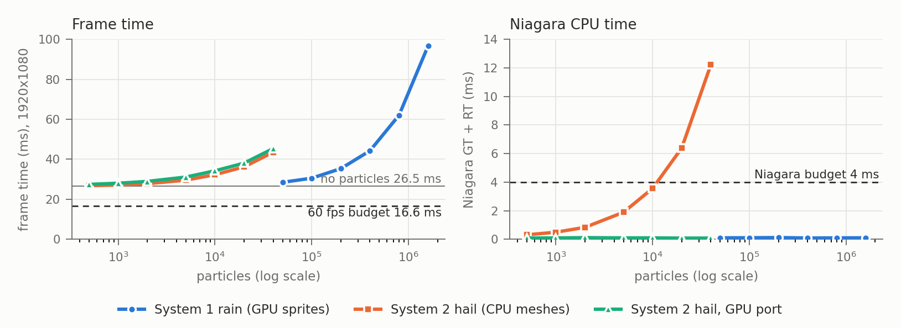

**Rain Shield** (UE 5.7, C++ + Niagara). A shape floats in a 10³ grid. The player places the blocker pieces the level gives them and picks the direction the weather comes from (26 directions, locked once it starts). Then the weather falls for a fixed time, and the stars depend on how wet the shape gets. The mechanic borrows from *Auditorium*: particle streams shaped by the geometry the player places. Two configurations of the same mechanic switch at runtime (G):

- **System 1, rain:** 200k GPU sprites with 3 rules: fall along the chosen direction, divergence-free gusts, and swept collision against the grid. Blockers absorb drops.
- **System 2, hail:** 2k CPU-simulated meshes. Stones bounce off blockers, rest on them, melt, and wear blockers down until they break.

**Two-way coupling.** Player input writes Niagara user parameters: 32 grid boxes, the direction, active/scored flags. The simulation writes back to gameplay through *Export Particle Data*:

- Each rain drop that hits the shape exports once, on the frame it hits (GPU readback, about 2–3 frames late), and is moved one stream period upwind. This keeps the incoming flux constant, so the expected hits on an unshielded shape can be computed: drops/cm³ × mean fall speed × outline × time. Unshielded runs read back 98–102 % of that estimate, which validates the readback and normalises the score. Changing `rain.game.Count` does not change the result.
- The GPU export buffer holds 4096 records per frame. Peak use was 121 per frame at 200k drops, and the HUD flags any frame that fills the buffer.
- Each hail impact exports (box kind, speed, mass). Impacts on the shape count as hits; impacts on a blocker drain its hit points, and when they run out the game removes the piece and re-uploads the boxes.

## Budget and method

**Target budget:** 60 fps (16.6 ms) at 1920×1080, with Niagara ≤ 4 ms on the game and render threads combined. As a working sub-budget, the particles may use ≤ 4 ms of GPU.

**Method:**

- **Machine:** MacBook Pro M2 Pro, 32 GB, Metal SM6; UE 5.7 Development. There was no lab PC to test on.
- **Run conditions:** standalone `-game` window at 1920×1080, 100 % screen percentage (the Retina default had been 72.9 %), uncapped frame rate, vsync off.
- **Per level:** `rain.game.Sweep` sets each count, then:
  1. waits until Niagara's live particle count matches the requested count;
  2. records 5 s of frames: `stat unit` raw frame, game-thread and GPU times, plus per-system Niagara game- and render-thread time from the engine's particle perf stats;
  3. writes a CSV (`Docs/Perf/`).
- **Cross-checks:** `stat Niagara`, the Niagara debug HUD, `ProfileGPU` and an Unreal Insights trace (screenshots in `Docs/Perf/`).
- **Metal limitations:** `stat GPU` is empty on Metal and per-system GPU time is not reported. The particles' GPU cost is therefore taken as GPU(N) − GPU(0), and it agrees with the ProfileGPU and Insights pass timings.

| | count | frame ms | particle GPU ms | Niagara GT+RT ms | events/s |
|---|---:|---:|---:|---:|---:|
| none (scene only) | 0 | 26.5 | 0 | 0.05 | — |
| rain (GPU sprites) | 100k / **200k** / 1.6M | 30.6 / **35.3** / 96.9 | 4.2 / **9.1** / 70.6 | 0.11 / **0.12** / 0.10 | 1.3k / 2.5k / 19.9k |
| hail (CPU meshes) | **2k** / 10k / 20k | **27.8** / 32.3 / 36.2 | **1.6** / 6.2 / 10.0 | **0.83** / 3.56 / 6.39 | 58 / 354 / 434 |
| hail, GPU port | 2k / 10k / 20k | 29.0 / 34.2 / 38.1 | 2.5 / 7.8 / 11.8 | 0.11 / 0.10 / 0.08 | 58 / 276 / 459 |

## Scaling and breaking points

- **The scene alone misses 60 fps on this Mac.** With no particles the frame takes 26.5 ms. ProfileGPU at 200k drops: post-processing 13.7 ms (Metal lumps nested passes into it), deferred lighting 6.6 ms, Niagara GPU simulation 4.1 ms, rain translucency 4.1 ms, sort 0.2 ms.
  Particles are not what breaks 60 fps here, and per the brief the miss is explained rather than hidden. On a GPU 2–3× faster, typical of a lab PC, the scene would take roughly 9–13 ms; that is a projection, not a measurement.
- **System 1 is GPU-bound and linear:** 4.4 ms of GPU per 100k drops, about 44 ns per drop: simulation with 32 box tests and readback, sort, then the translucent sprite draw.
  - Niagara's CPU cost stays at 0.1 ms all the way to 1.6M drops, so the 4 ms Niagara budget never breaks.
  - The 4 ms particle GPU sub-budget breaks at about **95k drops**. The default of 200k drops costs 9.1 ms.
- **System 2 on the CPU breaks the Niagara budget at about 11.5k stones** (3.6 ms at 10k, 6.4 ms at 20k).
  - Each stone costs about 0.32 µs of game thread: branch-free VM code with 32 swept sphere-box tests, a state machine and an export.
  - Each stone also costs about 0.5–0.8 µs of GPU: the Engine sphere has 559 vertices, so 20k stones means 11M vertices.
  - The target range of 500–5000 stones costs 0.3–1.9 ms of CPU, inside the budget.

## Optimisations, before → after (same build, reproducible with the cvars)

1. **CPU → GPU port of the hail** (`rain.game.HailGPU 1`: the same HLSL with the sim target flipped).
   - At 20k stones, Niagara CPU time drops from 6.39 to 0.08 ms (−99 %), and the CPU breaking point disappears up to 40k.
   - Frame time gets worse: +1.9 ms at 20k (36.2 → 38.1 ms), because this machine is GPU-bound and the port moves the work onto the bottleneck.
   - Decision: the hail stays on the CPU at the target 2k stones. It costs 0.83 ms of CPU, leaves the GPU to the rain, and gets synchronous impact events. The port is the answer only when the 4 ms CPU budget is the constraint (above about 11.5k stones), or on a machine with GPU headroom.
2. **Pause and hide the unselected system** (`rain.game.PauseUnselected 0 → 1`).
   - Parked, invisible particles were still simulated, sorted and submitted. While hailing, the 200k parked drops cost 4.4 ms of GPU.
   - At 2k stones: 32.07 → **27.81 ms (−4.3 ms, −13 %)**.
   - The Niagara debug HUD found a second case of the same thing: the film rain (245k particles) kept simulating while hidden, because its actor re-activated itself after the game turned it off. Fixing it took 0.3 ms off the baseline.

Fixed bounds are on for every emitter, so no bounds are computed per frame. That was not measured separately.

## Many simple vs few complex

At equal frame time the two configurations are almost exactly matched: **200k drops (35.3 ms) ≈ 20k stones (36.2 ms)**, so one stone costs about as much as 10 drops.

- **Many simple particles** give a smooth, statistical flux. The score converges to its analytic expectation within 2 %, and the puzzle is pure geometry (which shadow the pieces cast). The cost is all GPU and linear, and the readback of 2.5k events/s is cheap.
- **Few complex particles** are individually readable and produce emergent outcomes: ricochets off a plate's edge, stones piling up on a blocker until it breaks. That makes placement tactical, but the score is noisier, and the CPU cost grows per particle with every rule added.

A lead engineer's version:

- Spend particle *count* where the player reads a field (rain, 200k).
- Spend per-particle *logic* where the player reads individuals (hail, 2k). Keep that logic on the CPU while it fits in about 1 ms, and port it to the GPU only when count, not logic, is the requirement.

## With another week

1. Profile on a lab PC (D3D12, where `stat GPU` works) and set the default counts from that data.
2. Add a game scalability preset: post-processing and deferred lighting take about 20 ms of the scene's GPU time here.
3. Replace the 559-vertex hail mesh with a low-poly or impostor version (an estimated 3–5 ms saving at 20k stones).
4. Add hail-to-hail neighbour queries (Particle Attribute Reader, or a spatial hash on the GPU port) so stones pile up and knock each other off.
5. Use Effect Type budgets so the counts scale down automatically.
